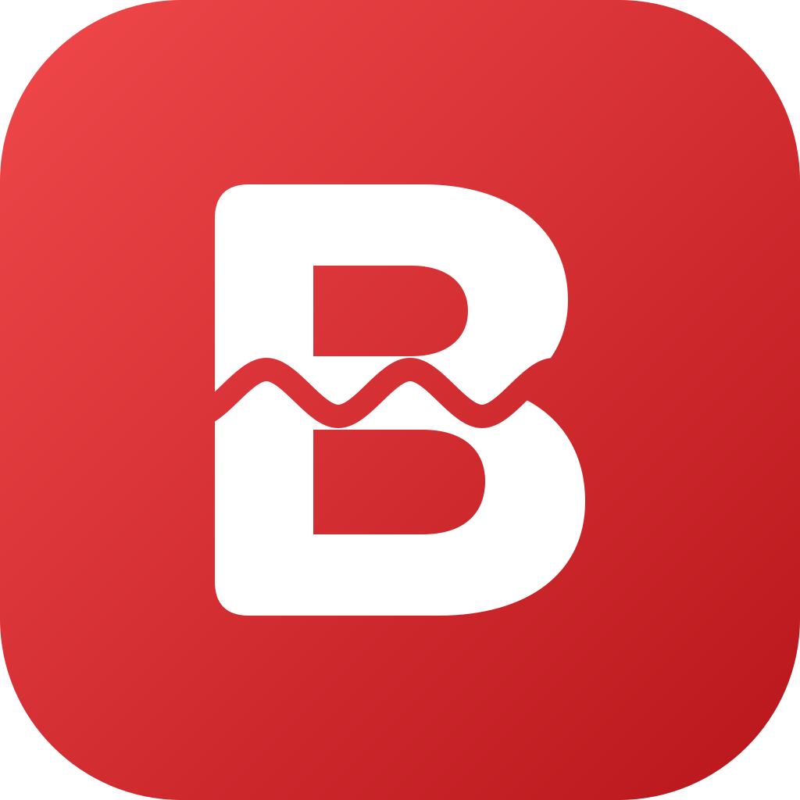

# Blednify

A fast, ad-free, Spotify-like music player for phones (Android 16 first, iOS too, plus an installable web app
for iPhone), backed by your own self-hosted music server. No ads, no tracking, no accounts.

- **Stream or download** from a Blednify server that indexes a folder of your audio files
  (mp3, flac, m4a, aac, ogg, opus, wav).
- **Import your own files** from the phone. They stay on the device and are never uploaded.
- Gapless playback, background audio with lock-screen and notification controls, queue with drag reorder,
  likes, playlists, recently played, instant search over local and server music, offline downloads
  (Wi-Fi only by default).

- **Add music from Settings:** search for a song or album and pick it, or paste a YouTube Music playlist link. The server downloads each song from YouTube Music
  (yt-dlp, included in the Docker image), or from a torrent through your Jackett and TorrServer, and adds it to the library. Setup is in [`apps/server/README.md`](apps/server/README.md).

## Repository

```
apps/server/            Bun + Hono + SQLite (FTS5) music server, Dockerfile, docker-compose.yml
apps/mobile/            Expo SDK 58 app (expo-router, expo-audio, expo-sqlite, MMKV, FlashList, Reanimated)
docs/API.md             server <-> app contract (v1), the single source of truth for both sides
docs/MOBILE_ARCH.md     mobile module contract: core/ui ownership, the @/core API, routes, performance rules
.github/workflows/      CI: checks, server Docker image
```

## Run the server

```sh
cd apps/server
bun install
MUSIC_DIR=~/Music ADMIN_TOKEN=change-me bun start      # http://0.0.0.0:8787
```

Or with Docker: `docker compose up -d` in `apps/server` (mounts `./music`). Environment variables, indexing,
search, streaming and upload behaviour are documented in [`apps/server/README.md`](apps/server/README.md).

Quick check: `curl http://localhost:8787/api/health`.

## Run the app

```sh
cd apps/mobile
bun install
bunx expo run:android        # development build on a device or emulator (Expo Go is not supported)
```

In the app open **Settings → Server**, enter the server address (for example `192.168.1.10:8787`; `http://` is
added if missing) and tap **Test**. To bake in a default, set `EXPO_PUBLIC_API_URL` at build time.
More in [`apps/mobile/README.md`](apps/mobile/README.md).

## iPhone web app

The server image also serves a web version of the app at its own address, so no App Store or Xcode is needed.
Open `http://<server>:8787` in Safari, then **Share → Add to Home Screen**. It connects to the server it was
opened from. Without Docker: `bun run build:web` in `apps/mobile`, then start the server with
`WEB_DIR=<path to apps/mobile/dist>`.

It covers streaming: browsing, search, queue, lock-screen controls, likes and playlists. Likes and playlists are
stored in that browser, not on the server. Compared to the native app:

- No downloads, file import or offline playback.
- Track changes are not gapless, because the browser loads each file as the previous one ends.
- Ogg files need a recent iOS; mp3, m4a, aac, flac and wav are the safe formats.
- Plain `http://` works on a LAN. Put HTTPS in front (reverse proxy, Tailscale) to use it away from home.

## CI and downloads

[`.github/workflows/ci.yml`](.github/workflows/ci.yml) runs on every push and pull request:

| Job | What it does |
|---|---|
| Server · typecheck + test | `bun run typecheck`, `bun test` in `apps/server` |
| Mobile · typecheck + lint + doctor | `tsc --noEmit`, `expo lint`, `expo-doctor` in `apps/mobile` |
| Server · Docker image | pushes `ghcr.io/<owner>/blednify-server:latest` and `:<sha>` (main and `v*` tags) |

CI builds no APK or iOS app: this fork ships the web app, which the server image serves.
